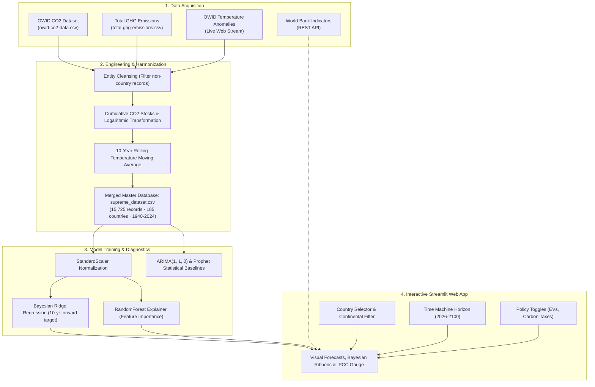

# Supreme Climate: Global Warming Simulation & Data Analysis Platform

[](https://www.python.org/)
[](https://streamlit.io/)
[](https://scikit-learn.org/)
[](https://plotly.com/)
[](LICENSE)

An end-to-end climate data science, predictive machine learning, and interactive simulation platform. **Supreme Climate** allows policymakers, researchers, and climate analysts to run counterfactual experiments: **"What if the entire planet consumed resources and emitted greenhouse gases like a specific country?"**

By synthesizing **85 years of empirical historical climate data (1940-2024)** across **185 sovereign nations**, the platform integrates Bayesian uncertainty modeling, IPCC-aligned sea-level projections, policy stress-testing, and live telemetry indicator updates via the World Bank API.

---

## Table of Contents

- [Key Features](#key-features)
- [Architecture & Data Pipeline](#architecture--data-pipeline)
- [Machine Learning & Scientific Methodology](#machine-learning--scientific-methodology)
  - [Radiative Forcing & Logarithmic Accumulation](#1-radiative-forcing--logarithmic-accumulation)
  - [Bayesian Ridge Modeling & Honest Uncertainty](#2-bayesian-ridge-modeling--honest-uncertainty)
  - [Counterfactual Global Scaling](#3-counterfactual-global-scaling)
  - [IPCC Sea-Level Rise Calibrations](#4-ipcc-sea-level-rise-calibrations)
- [Project Directory Structure](#project-directory-structure)
- [Installation & Quick Start](#installation--quick-start)
- [Running the Interactive Web Application](#running-the-interactive-web-application)
- [Feature Importance Breakdown](#feature-importance-breakdown)
- [Data Preparation & Notebooks](#data-preparation--notebooks)
- [Data Sources & Acknowledgments](#data-sources--acknowledgments)
- [License](#license)

---

## Key Features

### 1. The Counterfactual Time Machine
- **Global & Regional Country Filtering**: Explore 185 unique nations across 6 continents (*Africa, Asia, Europe, North America, South America, Oceania*).
- **Target Horizon Simulation**: Move smoothly across a continuous timeline from **2026 to 2100**.
- **Equitable Planetary Scaling**: Calculates a nation's per-capita emission fingerprint ($\text{CO}_2$, $\text{CH}_4$, $\text{N}_2\text{O}$) and simulates planetary climate response if all 8 billion people mirrored that lifestyle.

### 2. Climate Policy Intervention Sandbox
Stress-test global climate mitigation pledges to see if technological shifts can avert irreversible tipping points:
- **Global EV Revolution**: Models deep global electrification with **-20% CO2** and **-5% Methane ($\text{CH}_4$)** reductions.
- **Aggressive Carbon Taxation**: Enforces regulatory caps across all sectors with **-10% CO2**, **-10% $\text{CH}_4$**, and **-10% $\text{N}_2\text{O}$** reductions.

### 3. Probabilistic Bayesian Climate Inference
- **Honest 95% Confidence Intervals**: Replaces misleading point predictions with probabilistic Bayesian distributions ($\pm 1.96 \sigma$).
- **Extrapolation Penalty**: Mitigates artificial overconfidence when projecting far into the future through a distance-based penalty function:
  $$\sigma_{\text{honest}} = \sigma_{\text{Bayes}} + 0.02 \times \left(\frac{\text{Target Year} - \text{Base Year}}{10}\right)$$
- **Paris Agreement 1.5°C Boundary**: Real-time visual alerts indicating whether an emission path crosses dangerous warming thresholds.

### 4. Multi-Hazard Risk & Coastal Projections
- **Interactive Gauges**: Real-time classified risk zones:
  - **Safe Zone**: Temperature Anomaly $< +1.0^\circ\text{C}$
  - **Moderate Risk**: $+1.0^\circ\text{C} \le \text{Anomaly} \le +1.5^\circ\text{C}$
  - **Dangerous / Catastrophic**: $\text{Anomaly} > +1.5^\circ\text{C}$
- **IPCC Coastal Impact Interpolation**: Computes projected sea-level rise in meters corresponding to global surface temperature anomalies.

### 5. Explainable AI (XAI)
- Transparent model explainability powered by Random Forest permutation importances, highlighting the relative contribution of each greenhouse gas, population, and cumulative atmospheric stocks.

### 6. Global Climate Safety Ranking & Regional Analytics
- Multi-criteria composite risk scoring:
  $$\text{Risk Score} = 0.4 \times \widetilde{\text{CO}}_2 + 0.3 \times \widetilde{\text{Total GHG}} + 0.3 \times \widetilde{\text{Average Temp}}$$
- Identifies the nations with the lowest carbon footprints and highest climate resilience.

### 7. Live World Bank Telemetry API
- Integrated live REST client querying the World Bank Open Data API for real-time Population (`SP.POP.TOTL`), GDP (`NY.GDP.MKTP.CD`), and $\text{CO}_2$ emissions (`EN.ATM.CO2E.KT`).

---

## Architecture & Data Pipeline



---

## Machine Learning & Scientific Methodology

### 1. Radiative Forcing & Logarithmic Accumulation
Atmospheric physics establishes that temperature anomalies respond logarithmically to greenhouse gas concentrations rather than linearly (the classic Arrhenius radiative forcing formula):
$$\Delta F = \alpha \ln\left(\frac{C}{C_0}\right)$$
To reflect this physical principle, the feature engineering pipeline constructs:
$$\text{Log\_Cumulative\_CO}_2 = \ln(1 + \sum \text{CO}_2)$$
This prevents linear model blow-up and grounds simulated warming dynamics in atmospheric thermodynamics.

### 2. Bayesian Ridge Modeling & Honest Uncertainty
Unlike standard linear or black-box neural models that provide overconfident single estimates, **Supreme Climate** deploys a **Bayesian Ridge Regression** architecture:
$$y \sim \mathcal{N}(Xw, \sigma^2 I), \quad w \sim \mathcal{N}\left(0, \lambda^{-1} I\right)$$
- **Target**: 10-year forward global temperature anomaly ($\text{Temp\_Anomaly}_{t+10}$).
- **Feature Matrix**: `['Year', 'CO2_Emissions', 'Log_Cumulative_CO2', 'Population', 'Methane_Emissions', 'Nitrous_Oxide_Emissions']`.
- **Validation**: Achieves an in-sample training **Mean Absolute Error (MAE) of $\pm 0.12^\circ\text{C}$**.
- **Variance Prediction**: Provides posterior variance $\sigma_{\text{pred}}$ alongside predictions to construct 95% confidence intervals ($y \pm 1.96 \sigma$).

### 3. Counterfactual Global Scaling
For any chosen nation $i$ at current historical baseline:
$$\text{Emission}_{\text{capita}, i} = \frac{\text{Emissions}_i}{\text{Population}_i}$$
$$\text{Simulated Global Emissions} = \text{Emission}_{\text{capita}, i} \times P_{\text{global}, 2026} \quad (P_{\text{global}} = 8 \times 10^9)$$
Policy adjustments ($\delta_{\text{EV}}$, $\delta_{\text{Tax}}$) are applied dynamically:
$$\text{Emissions}_{\text{effective}} = \text{Simulated Global Emissions} \times (1 - \delta_{\text{EV}}) \times (1 - \delta_{\text{Tax}})$$

### 4. IPCC Sea-Level Rise Calibrations
Sea-level response is projected via calibrated piecewise linear interpolation derived from Intergovernmental Panel on Climate Change (IPCC) assessment scenarios:

| Global Temperature Anomaly | Projected Sea-Level Rise | Risk Classification |
|:--------------------------:|:------------------------:|:-------------------:|
| **$+1.0^\circ\text{C}$**   | **0.10 m**               | Safe                |
| **$+1.5^\circ\text{C}$**   | **0.30 m**               | Moderate            |
| **$+2.0^\circ\text{C}$**   | **0.50 m**               | High Impact         |
| **$+4.0^\circ\text{C}$**   | **1.00 m+**              | Severe Coastal Loss |

---

## Project Directory Structure

```plaintext
global-warming-sim-data-analysis-/
├── app.py                      # Main Streamlit web application & dashboards
├── requirements.txt            # Python package dependencies
├── .gitignore                  # Git ignore rules for virtualenvs, caches & checkpoints
├── README.md                   # Comprehensive project documentation
│
├── data/
│   ├── raw/                    # Primary source datasets (immutable)
│   │   ├── owid-co2-data.csv           # Our World in Data CO2 & greenhouse emissions
│   │   └── total-ghg-emissions.csv     # Annual aggregate greenhouse gas historical time series
│   └── processed/              # Cleaned & engineered datasets
│       ├── supreme_dataset.csv         # Harmonized master dataset (15,725 rows × 14 columns)
│       ├── feature_importance.csv      # Random Forest feature importance rankings
│       └── future_forecast.csv         # Prophet time-series baseline forecasts
│
├── models/                     # Serialized machine learning artifacts
│   ├── supreme_nn_model.pkl    # Trained BayesianRidge temperature regression model
│   ├── supreme_scaler.pkl      # Fitted StandardScaler for inference features
│   ├── prophet_model.pkl       # Serialized Facebook Prophet time series model
│   └── prophet_model.json      # Prophet model parameters in JSON format
│
├── notebooks/                  # Interactive exploratory data science workflows
│   ├── data_prep.ipynb         # Full reproducible pipeline: ingest, clean, train, baseline
│   └── data prep BROKEN.ipynb  # Historical experimental iterations & Prophet tuning
│
└── src/                        # Modular Python source library
    ├── __init__.py             # Package marker
    ├── api_service.py          # World Bank API client for real-time country stats
    ├── config.py               # Constants, path configurations, and continent mappings
    └── utils.py                # Reusable dataset loaders and regional filtering logic
```

---

## Installation & Quick Start

### 1. Prerequisites
- **Python**: Version `3.10` or higher (`3.11` / `3.12` recommended)
- **Git**: Installed and available on your system path

### 2. Clone the Repository
```bash
git clone https://github.com/TheJudge26/global-warming-sim-data-analysis-.git
cd global-warming-sim-data-analysis-
```

### 3. Create and Activate a Virtual Environment

**On Windows (PowerShell):**
```powershell
python -m venv venv
.\venv\Scripts\Activate.ps1
```

**On Linux / macOS:**
```bash
python3 -m venv venv
source venv/bin/activate
```

### 4. Install Dependencies
Install all required packages with pip:
```bash
pip install -r requirements.txt
```

> **Note on optional tools**: For running the interactive Jupyter notebooks with ARIMA and Prophet, you can optionally install:
> ```bash
> pip install statsmodels prophet jupyterlab
> ```

---

## Running the Interactive Web Application

Launch the Streamlit dashboard:

```bash
streamlit run app.py
```

Once started, open your web browser at:
```
http://localhost:8501
```

### Interactive Usage Guide:
1. **Choose Region & Country**: Use the sidebar/selectors to pick a continent or browse all 185 countries.
2. **Set the Target Horizon**: Adjust **"The Time Machine"** slider between 2026 and 2100.
3. **Toggle Policy Measures**: Activate the **EV Revolution** or **Carbon Tax** checkboxes to evaluate mitigation strategies.
4. **Click "Run Simulation"**:
   - Inspect the **Simulated Temperature Anomaly Gauge**.
   - Check the **IPCC Sea-Level Rise projection**.
   - Review the **Predictive Trajectory with Bayesian Uncertainty Ribbon**.
   - Compare national standings in the **Global Climate Safety Ranking**.

---

## Feature Importance Breakdown

The model’s decisions are explained using tree-based feature attribution:

| Feature | Description | Importance Share |
|:---|:---|:---:|
| **`CO2_Emissions`** | Annual global carbon dioxide release | **28.77%** |
| **`Methane_Emissions`** | Potent short-lived climate pollutant ($\text{CH}_4$) | **20.64%** |
| **`Year`** | Secular temporal trend & technological drift | **13.97%** |
| **`Log_Cumulative_CO2`** | Log of cumulative historical $\text{CO}_2$ atmospheric stock | **13.96%** |
| **`Population`** | Planetary demographic pressure | **13.19%** |
| **`Nitrous_Oxide_Emissions`**| Long-lived greenhouse gas ($\text{N}_2\text{O}$) | **9.48%** |

---

## Data Preparation & Notebooks

The full data engineering and model training pipeline is documented and reproducible in `notebooks/data_prep.ipynb`:

1. **Stage 1: Setup**: Sets up environments, directory structures, and imports.
2. **Stage 2: Ingestion & Merging**: Joins Our World in Data $\text{CO}_2$ records, greenhouse gas series, and temperature anomalies from live OWID endpoints.
3. **Stage 3: Feature Engineering**: Computes cumulative carbon emissions, logarithmic transforms, decadal aggregations, and rolling temperature metrics.
4. **Stage 4: Bayesian Training**: Fits the `BayesianRidge` regressor, serializes model weights to `models/supreme_nn_model.pkl`, and exports feature importances.
5. **Stage 5: Baseline Benchmarking**: Fits an **ARIMA(1, 1, 0)** time-series model, extracts 60-year baseline statistical projections, performs additive time-series decomposition (*Trend, Seasonal, Residual*), and generates correlation heatmaps.

To run the notebook:
```bash
jupyter lab notebooks/data_prep.ipynb
```

---

## Data Sources & Acknowledgments

- **[Our World in Data (OWID)](https://github.com/owid/co2-data)**: Comprehensive historical $\text{CO}_2$ and greenhouse gas emissions database.
- **[World Bank Open Data](https://data.worldbank.org/)**: Live economic, population, and emissions indicators.
- **[Intergovernmental Panel on Climate Change (IPCC)](https://www.ipcc.ch/)**: Benchmark scenarios for sea-level rise and global mean surface temperature limits.
- **[Streamlit](https://streamlit.io/) & [Plotly](https://plotly.com/)**: Fast, beautiful interactive scientific visualization.

---

## License

This project is licensed under the [MIT License](LICENSE) - feel free to use, modify, and distribute for educational, scientific, and commercial purposes.
